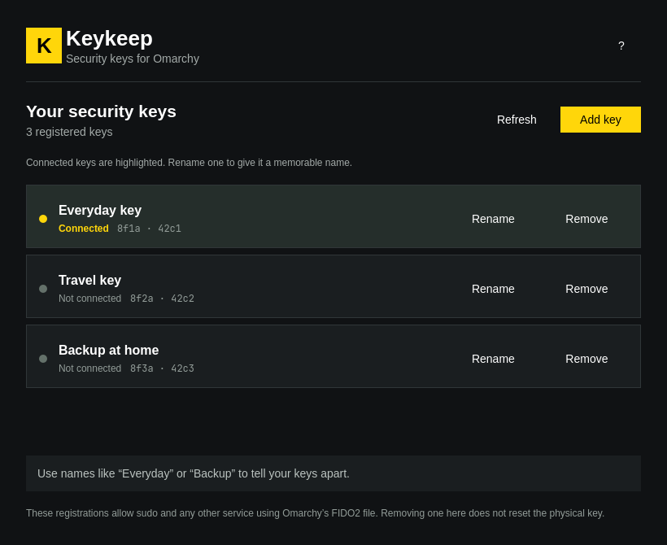

# Keymarchy

A small native app for managing the FIDO2 security keys used by sudo on Omarchy.
List your registrations, give them memorable names, add a key with a touch, and
remove a selected registration without manually editing authentication files.

## Install

On Omarchy, clone the project and build the package:

```sh
git clone https://github.com/Razumasu/keymarchy.git
cd keymarchy
./bin/install
```

This builds, tests, and installs an Arch package. Open **Keymarchy** in the app
launcher (`Super + Space`), or run `keymarchy open`.

Dependencies: Qt 6 base, declarative and Wayland, pam-u2f, libfido2, and polkit.
Building needs GCC, make, and qmake6. The PKGBUILD is in `pkgbuild/`.
Source archives are available on the [releases page](https://github.com/Razumasu/keymarchy/releases).
Extract an archive and run `./bin/install` inside it to install a specific release.
This installation does not enable FIDO2 or change your PAM configuration.

AUR and Omarchy repository submissions are being prepared. Until they are
accepted and published, use the source installation above.

## Use

- **Add key:** connect only the key to enroll, choose a name, touch it when it
  flashes, and approve the system authentication prompt to save it.
- **Identify and rename:** plug in a key. Its registration shows **Connected**
  and is highlighted automatically, usually within three seconds. Use Rename
  to give it a name such as Everyday, Travel, or Backup at home. Unplug it and
  plug in the next key to name the rest. No touch or password is needed for detection.
- **Remove:** choose a registration and confirm. Removing the last registration
  leaves password authentication in place.
- **Refresh:** reload registrations changed by another tool.

Keymarchy manages the standard Omarchy FIDO2 setup, using `/etc/fido2/fido2`.
If FIDO2 has never been configured, first enroll a key through Omarchy's
**Setup > Security > FIDO2** menu. Keymarchy then manages additional keys.
Custom PAM origins, authfile paths, and pam-u2f defaults are currently rejected
with an explanation, rather than guessed.

Existing registrations have no device name or serial number. They initially
appear as Key 1, Key 2, etc., in file order, with a stable registration fingerprint.
Those generated numbers can change after removal; assign names before relying
on them. A fingerprint identifies a *registration*, not a physical device.
The same physical key can have multiple registrations; all matching entries
are highlighted when it is connected. Multiple connected keys are supported.
If none match, the app reports an unregistered key. If a key cannot be queried
(for example, because it requires verification or another app is using it),
the app shows an unknown state rather than claiming it is disconnected.

Adding a key enrolls it; it is not a sudo authentication test. To verify it,
leave only that key connected and run `sudo -k -v`, then touch it when prompted.

The registration file is also used by polkit on standard Omarchy installations.
Removing a registration affects every service using this file. It does not erase
passkeys, SSH credentials, or any other data on the physical YubiKey.

## Command line

```sh
keymarchy list --json
keymarchy add "Backup at home" --json
keymarchy rename FULL_REGISTRATION_ID "Travel key" --json
keymarchy remove FULL_REGISTRATION_ID --yes --json
```

The `list` output includes `connection` (`connected`, `disconnected`, or `unknown`)
and matching device descriptions. Use the full ID returned by `list`. Commands run without a display; saving an
addition or removal invokes `pkexec`, which may use a graphical authentication
agent or a terminal prompt. Run as your regular user. Exit status is 0 on success,
1 on failure. With `--json`, stdout contains JSON and progress/errors go to stderr.

`keymarchy skill install` installs the bundled agent instructions under
`~/.agents/skills/keymarchy/`.

## Keyboard

| Key | Action |
| --- | --- |
| Space / Ctrl+N | Add key |
| Up / Down | Select a registration when the list has focus |
| F2 | Rename selected registration |
| Delete | Confirm removal of selected registration |
| Ctrl+R | Refresh |
| ? | Show shortcuts |
| Q | Quit |

Typing in a dialog does not activate these shortcuts. The window stays open
while an operation is in progress. Enrollment can be cancelled before saving;
close the system authentication prompt to decline a save.

## Storage and recovery

The GUI runs unprivileged. Only `/usr/bin/keymarchy --helper`, launched through
`pkexec`, writes the registration file. It derives the requesting user from
`PKEXEC_UID`, restricts edits to that user's row, checks ownership and file types,
locks concurrent Keymarchy changes, rejects stale revisions, and writes atomically.
It neither edits PAM nor grants new sudo privileges.

Each successful addition or removal creates a root-only backup named
`/etc/fido2/fido2.backup.XXXXXX`. The backup path appears after saving. Restoring
one restores the *entire* mapping file, including other users and keys, so an
administrator should inspect it before replacing the current file.

Existing names from Keykeep are read automatically if no Keymarchy names file
exists. The next name edit copies them into the new location.

Names are stored separately in `~/.local/share/keymarchy/labels.json`, keyed by
registration fingerprint. They are descriptive and have no authentication role.
Removal keeps the label so restoring a registration also restores its name.
There is no automatic undo of an authentication change.

## Connected-key detection

Detection uses libfido2's silent credential check, with user presence disabled
for this discovery request only. FIDO2 matches are verified against the saved
public key using a fresh random challenge. Legacy U2F keys use the protocol's
check-only response. This does not change the touch/PIN requirements for sudo,
the registration file, or the key's configuration. Signed checks can advance
the authenticator's signature counter, as normal FIDO assertions do.

The GUI checks for device changes every three seconds in a separate process.
It caches successful results by registration revision, hostname, and device-node
generation, so idle polling does not repeatedly ask the key for assertions.
Refresh forces a new check. Detection pauses during enrollment and saving.

Reference: [Yubico libfido2 assertions](https://developers.yubico.com/libfido2/Manuals/fido_dev_get_assert.html).

## Development

```sh
./bin/build
./bin/test
QT_QPA_PLATFORMTHEME=basic QT_QPA_PLATFORM=offscreen QT_QUICK_BACKEND=software \
  ./build/keymarchy --preview docs/screenshot.png
```

C++ owns registration parsing, processes, and disk operations. Qt Quick owns the
interface. Tests use temporary directories for write operations and exercise
the real QML dialogs offscreen. Preview mode uses fictional names and cannot
change registrations. Theme accent, window rounding, and language follow Omarchy;
English and Danish are included, with English fallback for other languages.

The security key integration uses [Yubico's pam-u2f](https://developers.yubico.com/pam-u2f/).
Atomic name storage uses [Qt QSaveFile](https://doc.qt.io/qt-6/qsavefile.html).
Theme and translation templates are adapted from the Omarchy app conventions
(MIT, David Heinemeier Hansson).

See [CONTRIBUTING.md](CONTRIBUTING.md) for checks and release steps.
